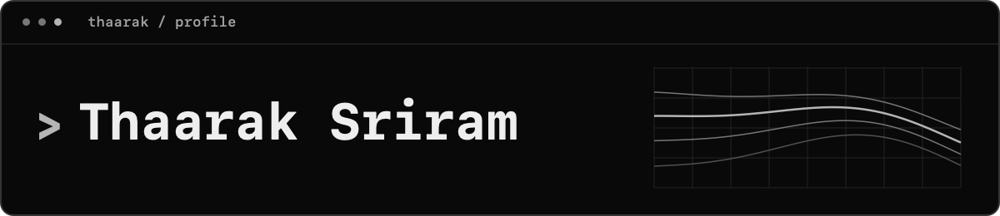

## Hey, I’m Thaarak 👋

I’m a UC San Diego student studying data science + physics. I do research in climate modeling and human–computer interaction, and I’m interested in how we evaluate AI systems and make them safer to use.

**I build with** Python, JAX, TypeScript, and React.

[LinkedIn](https://www.linkedin.com/in/thaarak-sriram-b5a19829b/) · [X](https://x.com/SriramThaa)
